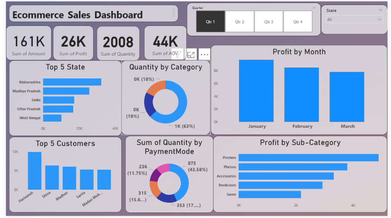

# Ecommerce Sales Analysis Dashboard | Power BI

## Project Overview

This project analyzes ecommerce sales performance using Microsoft Power BI. The dashboard provides insights into sales, profit, product categories, customer performance, and geographical trends.

## Dashboard Preview

## Business Objectives

- Monitor key business metrics such as sales, profit, quantity, and average order value.
- Identify the top-performing states and customers.
- Analyze quantity by product category and payment mode.
- Track monthly profit trends.
- Compare profit across product sub-categories.
- Explore data using Quarter and State filters.

## Tools and Technologies

- Microsoft Power BI
- Power Query for data cleaning and transformation
- DAX for measures and calculations
- CSV for source data

## Dashboard Features

- KPI cards for sales, profit, quantity, and AOV
- Top 5 States analysis
- Top 5 Customers analysis
- Quantity by Category
- Quantity by Payment Mode
- Monthly Profit Analysis
- Profit by Sub-category
- Interactive Quarter and State slicers
## How to Use
1. Download the Power BI report from the `dashboard` folder.
2. Open the `.pbix` file using Microsoft Power BI Desktop.
3. If prompted, update the data source path to your local dataset location.
4. Refresh the data if necessary.
## Key Learnings
- Data cleaning and transformation
- KPI creation and data visualization
- Sales and profit analysis
- Interactive dashboard development
- Business-focused data storytelling

## Future Improvements
- Add year-over-year sales and profit comparisons.
- Analyze the impact of discounts on profitability.
- Improve chart labels and formatting.
- Explore additional customer purchasing patterns.

## Author

**Ankit Yadav**

